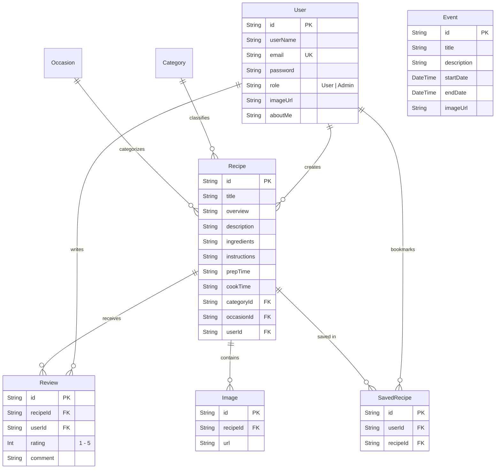

<p align="center">
  
</p>

<h1 align="center">CookBook</h1>

<p align="center">
  <strong>A premium, modern recipe management & culinary community platform.</strong>
</p>

<p align="center">
  
  
  
  
  
  
  
</p>

---

## 📖 Table of Contents

- [Overview](#-overview)
- [Key Features](#-key-features)
  - [Recipe Discovery & Exploration](#-recipe-discovery--exploration)
  - [Interactive Recipe Creation & CRUD](#-interactive-recipe-creation--crud)
  - [Social Reviews & Ratings](#-social-reviews--ratings)
  - [User Profile & Favorites](#-user-profile--favorites)
  - [Admin Command Center](#-admin-command-center)
  - [Design & User Experience](#-design--user-experience)
- [Tech Stack](#-tech-stack)
- [Architecture & Directory Structure](#-architecture--directory-structure)
- [Database Schema (Prisma ORM)](#-database-schema-prisma-orm)
- [Server Actions](#-server-actions)
- [Getting Started](#-getting-started)
  - [Prerequisites](#prerequisites)
  - [Installation](#installation)
  - [Environment Configuration](#environment-configuration)
  - [Database Setup & Seeding](#database-setup--seeding)
  - [Running the Application](#running-the-application)
- [Available Scripts](#-available-scripts)
- [Security & Access Control (RBAC)](#-security--access-control-rbac)
- [Design System & Palette](#-design-system--palette)
- [License](#-license)

---

## 🌟 Overview

**CookBook** is a full-stack culinary community platform designed for home cooks, food bloggers, and professional chefs. Built with **Next.js 16 (App Router)** and **MongoDB**, it enables users to publish detailed recipes with multi-image Cloudinary uploads, discover trending culinary creations, rate and review community dishes, and bookmark favorites.

The platform includes a dedicated **Admin Command Center** with high-density metrics and full content moderation over categories, occasions, culinary events, recipes, and users.

---

## 🚀 Key Features

### 🔍 Recipe Discovery & Exploration
- **Recipe of the Week & Popular Showcase**: Curated carousels and highlight sections spotlighting top-rated recipes.
- **Taxonomy Filtering**: Filter recipes dynamically by **Category** (e.g., Breakfast, Dinner, Vegan, Dessert) and **Occasion** (e.g., Party, Weekend, Holiday).
- **Culinary Events**: Browse culinary festivals, workshops, and gatherings with schedules and locations.
- **Responsive Recipe Cards**: Interactive cards with prep time, cook time, author details, and star ratings.

### 📝 Interactive Recipe Creation & CRUD
- **Step-by-Step Recipe Builder**: Guided progress tracker calculating form completion in real time.
- **Cloudinary Multi-Image Upload**: Attach multiple high-resolution photos per recipe with instant preview and fallback handling.
- **Rich Meta Information**: Track overview, ingredients, instructions, cooking times, difficulty, and chef notes.
- **Full Author CRUD**: Edit and delete your own recipes with instant cache revalidation (`revalidatePath`).

### ⭐ Social Reviews & Ratings
- **Interactive 5-Star Rating**: Dynamic rating widget with real-time client feedback.
- **Review System**: User comments and reviews backed by MongoDB compound constraints (`[userId, recipeId]`) to prevent duplicate reviews per user.
- **Calculated Averages**: Automatic score aggregation on recipe cards and detail pages.

### 👤 User Profile & Favorites
- **Saved Recipes**: One-click bookmarking to curate personal collections.
- **Chef Dashboard**: Overview of authored recipes, ratings received, and saved dishes.
- **Account Management**: Update user avatar (Cloudinary), display name, bio ("About Me"), and secure password reset.

### 🛡️ Admin Command Center
- **Role-Guarded Access**: Automatic server- and client-side guards redirecting non-admin users.
- **High-Density Dashboard**: Command-center analytics for quick data scanning.
- **Complete Content Moderation**:
  - **Recipes**: Inspect, edit, and moderate community posts.
  - **Categories & Occasions**: Add, update, and manage taxonomy with custom image icons.
  - **Events**: Schedule and publish culinary events with start/end dates.
  - **Users**: Manage member roles and account permissions.

### 🎨 Design & User Experience
- **Liquid Glassmorphism**: Translucent backdrops, cursor-following navigation underlines, and sleek dark mode support.
- **Framer Motion Micro-Animations**: Smooth modal transitions, expanding search triggers, and SVG icon morphing.
- **Typography**: Dual font system featuring **Inter** for modern Latin screens and **Noto Sans Khmer** for full Khmer script typography support.

---

## 🛠️ Tech Stack

| Layer | Technologies |
| :--- | :--- |
| **Framework** | [Next.js 16.2](https://nextjs.org/) (App Router, Turbopack, React Server Components, Server Actions) |
| **Library** | [React 19](https://react.dev/) |
| **Database** | [MongoDB Atlas](https://www.mongodb.com/) via [Prisma ORM v6](https://www.prisma.io/) |
| **Authentication** | [NextAuth.js v4](https://next-auth.js.org/) (Credentials + Google OAuth, JWT Strategy, Role-based) |
| **Styling** | [Tailwind CSS v4](https://tailwindcss.com/), [Framer Motion 12](https://www.framer.com/motion/) |
| **UI Components** | [Radix UI](https://www.radix-ui.com/), Material UI (MUI), [Lucide React](https://lucide.dev/), FontAwesome |
| **Media Storage** | [Cloudinary](https://cloudinary.com/) (Multi-file upload & asset optimization) |
| **Forms & Utilities** | `bcryptjs`, `clsx`, `tailwind-merge`, `swiper` |

---

## 📂 Architecture & Directory Structure

The project adheres to the standard Next.js **`src/`** architecture, cleanly separating routing from business logic, components, and utilities:

```
CookBooks/
├── prisma/                      # Database schema and seed scripts
│   ├── schema.prisma            # MongoDB Prisma model definitions
│   ├── seed.ts                  # Admin user initialization seed script
│   └── seed.js                  # Compiled seed runner
├── public/                      # Static assets
│   ├── cooks.svg                # Scalable brand vector logo & tab icon
│   ├── banner.png               # Hero carousel banner
│   └── images/                  # Fallback assets & icons
├── src/
│   ├── actions/                 # Next.js Server Actions (Database mutations & queries)
│   │   ├── authActions.ts       # Registration & authentication operations
│   │   ├── categoryActions.ts   # Category CRUD
│   │   ├── dashboardActions.ts  # Admin metric aggregation
│   │   ├── eventActions.ts      # Culinary events management
│   │   ├── occasionActions.ts   # Occasion taxonomy management
│   │   ├── recipeActions.ts     # Recipe queries, creation, edit & deletion
│   │   ├── reviewActions.ts     # Reviews & star rating calculations
│   │   └── userActions.ts       # User profiles & role administration
│   ├── app/                     # Next.js App Router
│   │   ├── (auth)/              # Authentication route group (/login, /register)
│   │   ├── (authenticated)/     # Protected user actions (/add-recipe)
│   │   ├── (public)/            # Public pages (/recipe/[id], /popular, /about-us, etc.)
│   │   ├── admin/               # Admin command center (/dashboard, /recipes, /users, etc.)
│   │   ├── api/auth/            # NextAuth catch-all route handler
│   │   ├── profile/[id]/        # User profile, bookmarks, and settings
│   │   ├── globals.css          # Tailwind CSS 4 root styles & CSS variables
│   │   ├── icon.svg             # Native browser tab icon (cooks.svg)
│   │   ├── layout.tsx           # Global RootLayout with font & metadata configuration
│   │   ├── not-found.tsx        # Branded 404 handler
│   │   └── page.tsx             # Home landing page
│   ├── components/              # Modular UI components
│   │   ├── ui/                  # Radix UI primitives (Button, Dialog, Badge, Card, Avatar)
│   │   ├── Navbar.tsx           # Glassmorphic header with hover underlines & search focus
│   │   ├── Footer.tsx           # Social links & platform directory
│   │   ├── AdminSlideBa.tsx     # Collapsible admin navigation drawer
│   │   ├── RecipeModal.tsx      # Taxonomy picker modal
│   │   └── recipe-card.tsx      # Responsive recipe display card
│   ├── context/                 # React Context providers (AlertContext)
│   ├── lib/                     # Core singletons and helper modules
│   │   ├── auth.ts              # NextAuth options & providers configuration
│   │   ├── cloudinary.ts        # Cloudinary SDK client
│   │   ├── cloudinaryHelper.ts  # Image upload buffer handler
│   │   ├── prisma.ts            # Global PrismaClient singleton
│   │   └── utils.ts             # Tailwind class merger (`cn`)
│   └── types.ts                 # Shared TypeScript interfaces & types
├── components.json              # shadcn UI CLI configuration
├── next.config.ts               # Next.js config (Cloudinary remote patterns)
├── package.json                 # Project dependencies & scripts
└── tsconfig.json                # TypeScript path aliases (@/* -> ./src/*)
```

---

## 🗄️ Database Schema (Prisma ORM)

The MongoDB database managed via [schema.prisma](prisma/schema.prisma) defines 8 primary collections:



---

## ⚡ Server Actions

All database operations use **Next.js Server Actions** (`"use server"`) located in `src/actions/`:

- **`recipeActions.ts`**:
  - `createRecipe(formData)`: Uploads attached image files to Cloudinary, links them with the new recipe entry, and calls `revalidatePath()`.
  - `getRecipes(filters)` / `getRecipeById(id)`: Reads recipe data including related category, occasion, author, images, and reviews.
  - `deleteRecipe(id)` / `updateRecipe(id, data)`: Modifies or cascades deletion of images and reviews.
- **`userActions.ts`**: Handles profile updating, user role elevation/demotion, and secure password updates via `bcryptjs`.
- **`reviewActions.ts`**: Implements upsert logic for 1–5 star ratings and recalculates recipe average ratings.
- **`categoryActions.ts` & `occasionActions.ts`**: Manages taxonomy entities for filtering.
- **`eventActions.ts`**: Handles culinary workshop and event scheduling.
- **`dashboardActions.ts`**: Aggregates statistical metrics for the Admin Command Center.

---

## 🛠️ Getting Started

### Prerequisites

- **Node.js**: `v18.18.0` or higher (Node 20+ recommended)
- **Package Manager**: `npm` (included with Node.js)
- **MongoDB**: A running instance (local MongoDB or [MongoDB Atlas](https://www.mongodb.com/cloud/atlas))
- **Cloudinary**: A free [Cloudinary account](https://cloudinary.com/) for media hosting

---

### Installation

1. **Clone the repository:**
   ```bash
   git clone https://github.com/VibolSen/CookBooks.git
   cd CookBooks
   ```

2. **Install project dependencies:**
   ```bash
   npm install
   ```

---

### Environment Configuration

Create a `.env` file in the root directory:

```env
# -------------------------------------------------------------
# DATABASE (MongoDB via Prisma)
# -------------------------------------------------------------
MONGODB_URI="mongodb+srv://<username>:<password>@cluster.mongodb.net/cookbook?retryWrites=true&w=majority"

# -------------------------------------------------------------
# NEXTAUTH (Authentication & Session Security)
# -------------------------------------------------------------
NEXTAUTH_URL="http://localhost:3000"
NEXTAUTH_SECRET="your-generate-secret-e.g.-openssl-rand-hex-32"

# -------------------------------------------------------------
# CLOUDINARY (Recipe & Avatar Image Hosting)
# -------------------------------------------------------------
CLOUDINARY_CLOUD_NAME="your_cloud_name"
CLOUDINARY_API_KEY="your_api_key"
CLOUDINARY_API_SECRET="your_api_secret"

# -------------------------------------------------------------
# OAUTH PROVIDERS (Optional)
# -------------------------------------------------------------
GOOGLE_CLIENT_ID="your_google_client_id.apps.googleusercontent.com"
GOOGLE_CLIENT_SECRET="your_google_client_secret"
```

---

### Database Setup & Seeding

1. **Generate Prisma Client:**
   ```bash
   npx prisma generate
   ```

2. **Push schema to MongoDB:**
   ```bash
   npx prisma db push
   ```

3. **Seed default Admin account:**
   ```bash
   # On Windows
   seed.bat
   # Or using Node directly
   node prisma/seed.js
   ```

---

### Running the Application

- **Development Mode (Turbopack enabled):**
  ```bash
  npm run dev
  ```
  Open [http://localhost:3000](http://localhost:3000) in your browser.

- **Production Build:**
  ```bash
  npm run build
  npm run start
  ```

---

## 📜 Available Scripts

| Script | Command | Description |
| :--- | :--- | :--- |
| `dev` | `next dev --turbopack` | Starts the Next.js local development server with Turbopack |
| `build` | `next build` | Compiles and validates TypeScript, generating static & dynamic pages |
| `start` | `next start` | Starts the production server |
| `lint` | `next lint` | Runs ESLint across the codebase |

---

## 🔒 Security & Access Control (RBAC)

The application supports two user roles:
- **`User`**: Default registered account. Can create recipes, write reviews, bookmark favorites, and manage their personal profile.
- **`Admin`**: Full privileges. Has access to `/admin` to moderate recipes, categories, occasions, culinary events, and manage all users.

Protected routes are guarded at two levels:
1. **Middleware ([proxy.ts](proxy.ts))**: Redirects unauthorized visitors to `/login` when trying to access `/add-recipe/*`.
2. **Layout Guards ([src/app/admin/layout.tsx](src/app/admin/layout.tsx))**: Validates that `session.user.role === 'Admin'` before rendering the administration panel.

---

## 🎨 Design System & Palette

Extracted from the brand identity ([cooks.svg](public/cooks.svg)):

| Color Name | Hex Code | Purpose |
| :--- | :--- | :--- |
| **Primary Brand Blue** | `#0084FA` | Buttons, active link indicators, highlights |
| **Deep Blue** | `#1873D0` | Hover states, depth elements |
| **Brand Orange** | `#E88604` | Accent touches, rating stars, badges |
| **Background Light** | `#FFFFFF` / `#F9FAFB` | Base light page background |
| **Background Dark** | `#111827` | Dark mode container backgrounds |

- **Primary Font**: **Inter** (Latin subsets via `next/font/google`)
- **Secondary Font**: **Noto Sans Khmer** for full Khmer script legibility
- **Dashboard Density**: High-density typography (`text-[9px]` to `text-xs`) configured for metric-rich administrative tables.

---

## 📄 License

Distributed under the **MIT License**. See `LICENSE` for more information.
